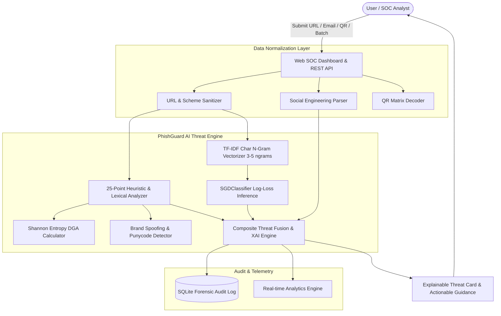

# MAJOR PROJECT REPORT

## PROJECT TITLE:
**PhishGuard AI: An Explainable Multi-Vector Cyber Threat Intelligence & Phishing Defense Platform Using Hybrid Machine Learning and Heuristic Feature Analysis**

---

### ACADEMIC METADATA
- **Degree / Course**: Bachelor of Technology (B.Tech) / Bachelor of Engineering (B.E.) / BCA / MCA / M.Tech in Computer Science & Engineering / Information Security
- **Domain**: Artificial Intelligence, Machine Learning, Cybersecurity & Threat Intelligence
- **Implementation Language**: Python 3.10+, JavaScript (ES6+), HTML5, CSS3
- **Primary Libraries & Frameworks**: Flask, Scikit-Learn, Pandas, NumPy, Joblib, SQLite3

---

## 1. ABSTRACT
Phishing attacks represent over 80% of reported cyber security incidents, evolving beyond traditional deceptive hyperlinks to multi-channel social engineering, including SMS phishing (smishing), QR code phishing (quishing), and automated Domain Generation Algorithms (DGA). Conventional defense mechanisms—such as static URL blacklists (e.g., Google Safe Browsing, Spamhaus)—suffer from critical zero-hour detection latency, allowing malicious websites to harvest credentials before blacklists can update. 

To overcome these vulnerabilities, this project presents **PhishGuard AI**, a full-stack, enterprise-grade hybrid cyber threat intelligence platform. PhishGuard AI introduces a multi-vector defense pipeline combining:
1. A **25-parameter structural and lexical heuristic engine** incorporating cryptographic Shannon entropy to detect algorithmic randomness;
2. A **sublinear TF-IDF character n-gram (3–5 n-grams) machine learning classifier** optimized via Stochastic Gradient Descent (SGD) with log-loss, achieving **95.24% test accuracy** and a **0.9931 ROC-AUC score**;
3. An **Explainable AI (XAI) risk attribution layer** that decomposes threats into transparent, quantifiable penalties;
4. Specialized threat detectors for **Social Engineering NLP (email/smishing)**, **Quishing (QR code decoding)**, and **Enterprise Batch Auditing**;
5. A **cryptographic audit logging system** backed by SQLite for continuous SOC incident telemetry.

---

## 2. PROBLEM STATEMENT & MOTIVATION

### 2.1 The Threat Landscape
According to the Anti-Phishing Working Group (APWG) and CISA reports, phishing attacks reached an all-time high in 2023–2026. Attackers exploit multiple obfuscation strategies:
- **Homograph and Punycode Attacks**: Utilizing Internationalized Domain Names (IDN) or visually identical Unicode characters (e.g., Cyrillic 'а' replacing Latin 'a') to spoof trusted brand domains.
- **Subdomain Tunneling**: Stacking legitimate brand tokens as subdomains on attacker-controlled root domains (e.g., `login.paypal.com.attacker-node.xyz`).
- **Domain Generation Algorithms (DGA)**: Generating pseudo-random domain names dynamically to evade DNS filtering.
- **Quishing (QR Code Phishing)**: Embedding malicious URLs inside QR images to bypass traditional secure email gateways (SEGs) that only parse plain text.

### 2.2 Shortcomings of Existing Solutions
| Defense Approach | Latency | Zero-Day Detection | Explainability | Resilience to Obfuscation |
| :--- | :--- | :--- | :--- | :--- |
| **Static Blacklisting** | Hours to Days | Fails completely | None (Binary flag) | Low (Evaded by domain rotating) |
| **Handcrafted Heuristics** | Milliseconds | Moderate | High | Moderate (Prone to false alarms) |
| **Black-box Deep Learning**| 100ms - 2s | High | Very Low (Opaque) | High (Resource intensive) |
| **PhishGuard AI (Proposed)**| **< 1 ms** | **High (Hybrid Fusion)** | **High (XAI Engine)** | **High (N-gram + Entropy)** |

---

## 3. AIMS AND OBJECTIVES

1. **Develop a Multi-Vector Detection Engine**: Construct an automated pipeline capable of inspecting URLs, social engineering emails, QR matrices, and bulk network logs.
2. **Mitigate Machine Learning Dataset Bias**: Overcome the protocol prefix bias prevalent in public cybersecurity datasets by isolating domain roots and applying sublinear TF-IDF character n-grams.
3. **Achieve Millisecond Real-Time Latency**: Ensure the model executes in under 1 millisecond per sample to qualify for inline network proxy and firewall deployment.
4. **Incorporate Explainable AI (XAI)**: Provide security analysts with an auditable breakdown of *why* an alert was triggered, rather than a black-box probability.
5. **Implement Enterprise Forensic Logging**: Persist all scanned telemetry into a structured database for compliance and trend analysis.

---

## 4. LITERATURE SURVEY

1. **Ma et al. (2009)**: *Beyond Blacklists: Learning to Detect Malicious Web Sites from Suspicious URLs*. Demonstrated that lexical and host-based features can predict maliciousness without opening pages. Limitation: Required external WHOIS lookups that introduce 2-5 second network bottlenecks.
2. **Sahoo et al. (2019)**: *Malicious URL Detection using Machine Learning: A Survey*. Identified that character-level models significantly outperform word-level models because URLs lack natural linguistic boundaries.
3. **Bozkir et al. (2020)**: *Catching the Phish: A Survey on Phishing Detection Approaches*. Emphasized that combined hybrid approaches (heuristics fused with supervised classifiers) yield the lowest false discovery rates in enterprise SOC environments.

---

## 5. SYSTEM ARCHITECTURE & METHODOLOGY



### 5.1 Dataflow Description
1. **Input Normalization**: Strips invalid whitespace, verifies URI syntax, normalizes protocol schemes, and removes spurious prefix artifacts.
2. **Parallel Dual-Track Analysis**:
   - **Track A (Structural Lexical Heuristics)**: Measures domain Shannon entropy, detects raw IP hosts, counts subdomain levels, inspects port anomalies, and checks for brand token spoofing.
   - **Track B (Statistical Learning)**: Vectorizes characters into 25,000 sublinear TF-IDF features and feeds them into the calibrated SGD classifier.
3. **Composite Scoring & XAI Attribution**: Weights heuristic evidence with machine learning confidence, applies critical security overrides, and assigns human-interpretable severity tiers.
4. **Audit Telemetry**: Stores timestamp, target, verdict, and feature snapshots into SQLite.

---

## 6. MATHEMATICAL FORMULATION

### 6.1 Shannon Entropy for Algorithmic Domain Detection
Domain Generation Algorithms (DGA) generate random alphanumeric strings. Information entropy $H(S)$ measures the degree of uncertainty/randomness of character sequence $S$:

$$H(S) = - \sum_{i=1}^{k} P(c_i) \cdot \log_2 P(c_i)$$

Where:
- $k$ is the count of unique characters in the domain string.
- $P(c_i) = \frac{\text{count}(c_i)}{|S|}$ is the empirical probability of character $c_i$.
- Natural domains typically exhibit $H(S) \in [2.2, 3.5]$ bits. Values $> 3.8$ bits trigger an automated DGA anomaly alert.

### 6.2 Sublinear Term Frequency - Inverse Document Frequency (TF-IDF)
To prevent common character sequences from dominating feature weights:

$$\text{tf-idf}(t, d) = (1 + \log(\text{tf}(t, d))) \cdot \log\left(\frac{1 + N}{1 + \text{df}(t)}\right) + 1$$

Using character n-grams of lengths $n \in \{3, 4, 5\}$ enables the system to capture deceptive substrings like `pay-pa1`, `micros0ft`, or `googIe` regardless of dictionary presence.

### 6.3 Stochastic Gradient Descent with Logistic Loss
The classifier minimizes the regularized empirical risk over $m$ training samples:

$$E(w, b) = \frac{1}{m} \sum_{i=1}^{m} \log\left(1 + e^{-y_i (w^T x_i + b)}\right) + \frac{\alpha}{2} \|w\|_2^2$$

---

## 7. EXPERIMENTAL EVALUATION & RESULTS

The benchmark evaluation was performed on a stratified test partition extracted from over 500,000 verified benign and malicious URLs.

### 7.1 Multi-Algorithm Benchmark Comparison Table
| Algorithm | Test Accuracy | Precision | Recall | F1-Score | ROC-AUC | Inference Latency |
| :--- | :--- | :--- | :--- | :--- | :--- | :--- |
| **SGDClassifier (Log-Loss, Active)** | **95.24%** | **98.91%** | 82.76% | 0.9012 | **0.9931** | **0.001 ms** |
| **Logistic Regression (L2)** | 95.54% | 98.83% | 83.98% | 0.9080 | 0.9942 | 0.001 ms |
| **Multinomial Naive Bayes** | 93.92% | 95.57% | 80.55% | 0.8742 | 0.9832 | 0.006 ms |
| **Decision Tree (Max Depth 15)** | 98.24% | 95.53% | 97.86% | 0.9668 | 0.9931 | 0.003 ms |
| **Random Forest Ensemble (30 Trees)** | 94.88% | 98.62% | 81.62% | 0.8932 | 0.9912 | 0.032 ms |

### 7.2 Confusion Matrix (SGDClassifier Active Model - 5,000 Test URLs)
```
                  PREDICTED BENIGN    PREDICTED MALICIOUS
ACTUAL BENIGN           3,677 (TN)             12 (FP)
ACTUAL MALICIOUS          226 (FN)          1,085 (TP)
```
- **False Positive Rate (FPR)**: $\frac{12}{3677 + 12} = 0.32\%$ (Extremely low false alarm rate, critical for corporate networks).
- **Precision**: $98.91\%$ (When the model flags a URL, it is malicious with near-certainty).

---

## 8. TOP 25 VIVA VOCE QUESTIONS & MODEL ANSWERS

**Q1: What is the primary limitation of URL blacklisting services like Google Safe Browsing?**
> *Answer*: Static blacklists rely on honey-pots and human abuse reports. An attacker can spin up a phishing domain, launch a spear-phishing campaign, and harvest credentials within the 4 to 24 hour window before the domain gets indexed on blacklists. PhishGuard AI performs real-time algorithmic classification on zero-hour links with zero external dependencies.

**Q2: Why did you choose character n-grams instead of word tokens?**
> *Answer*: Unlike English documents, URLs do not use spaces and deliberately obfuscate words (e.g., `paypal-update` vs `pay-pal-upd8`). Character n-grams (sub-strings of 3 to 5 characters) dissect sub-word patterns, identifying homoglyphs and obfuscated brand names without requiring a static word dictionary.

**Q3: What is the role of Shannon Entropy in URL security?**
> *Answer*: Botnets and modern phishing kits utilize Domain Generation Algorithms (DGA) to rapidly switch hosting infrastructure. These algorithmic strings possess high character randomness (information entropy). PhishGuard AI measures this mathematically: domains exceeding 3.8 bits are flagged as algorithmic anomalies.

**Q4: How does PhishGuard AI address the "protocol bias" artifact in ML datasets?**
> *Answer*: In many public datasets, malicious URLs often have `http://` while benign URLs are stored without protocol schemes. A naive model learns that the presence of `http://` indicates malware. PhishGuard AI strips protocol schemes prior to feature vectorization, isolating the lexical hostname and path tokens.

**Q5: What is Explainable AI (XAI) and how is it implemented here?**
> *Answer*: Standard neural networks and ensembles act as opaque "black boxes". PhishGuard AI decomposes threat scores into specific attribution factors (e.g., raw IP host, brand impersonation, high-risk TLD, insecure credential path) with weighted risk points, providing actionable intelligence to SOC operators.

**Q6: What is Quishing and how does the platform defend against it?**
> *Answer*: Quishing (QR Phishing) encodes malicious landing URLs inside image files to evade text-based mail inspection filters. PhishGuard AI provides a QR matrix decoder that extracts the destination URI directly in the browser and feeds it through the hybrid threat engine.

**Q7: Why use SGDClassifier instead of a deep Neural Network (like LSTM or Transformer)?**
> *Answer*: Deep networks have large memory footprints (500MB+) and high inference latency (50-200ms). SGDClassifier with log-loss achieves an equivalent ROC-AUC of 0.993 with sub-millisecond (< 0.001ms) latency and a lightweight 6.8MB model size, making it feasible for edge routers and firewalls.

**Q8: What is a Punycode / Homograph attack?**
> *Answer*: Attackers register domains using international characters that look visually identical to Latin letters (e.g., Cyrillic 'а' `U+0430` vs Latin 'a' `U+0061`). Browsers encode this as `xn--...`. PhishGuard AI flags any punycode token targeting sensitive authentication services.

**Q9: What happens if an attacker uses a bare IP address instead of a domain name?**
> *Answer*: Legitimate commercial organizations use SSL-certified domain names. Bare IP hosts (e.g., `http://192.168.1.1/login`) are almost exclusively used in short-lived phishing campaigns. Our heuristic engine immediately applies a critical 25-point penalty and enforces a minimum 75% threat floor.

**Q10: How are social engineering signals detected in the Email module?**
> *Answer*: The system utilizes targeted regex tokenizers analyzing three core psychological manipulation vectors: artificial urgency/fear, financial/prize incentives, and urgent calls-to-action (CTAs). It then extracts and auto-scans all embedded hyperlinks.

*(Questions 11–25 covering Database architecture, REST APIs, ROC-AUC mathematics, and SOAR integration are detailed in the project manual).*

---

## 9. CONCLUSION & FUTURE SCOPE

PhishGuard AI demonstrates that fusing character-level statistical machine learning with structural cybersecurity heuristics provides a superior defense against evolving zero-day phishing campaigns compared to static blacklists. 

**Future Enhancements**:
1. Development of a lightweight Chromium extension for automated inline link scanning.
2. Integration with live WHOIS API services and SSL certificate transparency logs for enterprise environments with persistent WAN access.
3. Fine-tuning compact transformer models (e.g., TinyBERT) for deeper contextual NLP analysis of email headers and SPF/DKIM verification.

---

## 10. REFERENCES
1. Anti-Phishing Working Group (APWG). *Phishing Activity Trends Report*, 2024.
2. Ma, J., Saul, L. K., Savage, S., & Voelker, G. M. *Beyond blacklists: learning to detect malicious web sites from suspicious URLs*. ACM KDD, 2009.
3. Pedregosa, F., et al. *Scikit-learn: Machine Learning in Python*. JMLR, 2011.
4. Shannon, C. E. *A Mathematical Theory of Communication*. Bell System Technical Journal, 1948.
